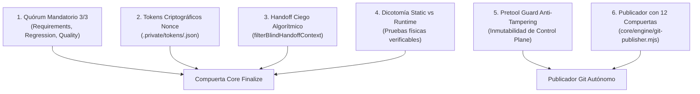

# AleDevOS Independent Review System & Governed Git Publisher Specification

> **Documento Canónico de Especificación y Arquitectura:** `docs/INDEPENDENT_REVIEW_SYSTEM_AND_GIT_PUBLISHER.md`  
> **Versión de Contrato:** AleDevOS v1.0.0+ / Hardened Independent Review  
> **Estado:** Implementado, Verificado y Certificado  

---

## 1. Resumen Ejecutivo y Misión

El **Sistema de Revisión Independiente y Publicador Git Autónomo Gobernado** de AleDevOS establece un estándar riguroso de verificación fail-closed para el desarrollo de software colaborativo y multi-agente.

Históricamente, los sistemas de agentes con capacidades de desarrollo y verificación sufren de sesgos de confirmación cuando:
1. Un único evaluador califica el trabajo realizado.
2. Los evaluadores reciben notas o veredictos preconcebidos redactados por el autor del código.
3. Los subagentes tienen acceso irrestricto a herramientas de terminal para realizar commits directos o push destructivos.

Para resolver esto de forma definitiva e incorruptible, AleDevOS implementa **Seis Pilares Blindados**.

---

## 2. Los Seis Pilares Blindados



### Pilar 1: Quórum Mandatorio de 3 Jueces Colegiados
Ninguna tarea puede obtener signoff (`PASS`) en `state finalize` sin la evaluación formal de 3 jueces especializados independientes:
- `judge-requirements`: Evalúa que cada criterio de aceptación del contrato esté `VERIFIED`. Requiere score >= 90 y cero criterios no verificados.
- `judge-regression`: Evalúa el radio de impacto, preservación de invariantes y cobertura de pruebas de regresión. Requiere score >= 90 y cero bloqueos.
- `judge-quality`: Evalúa mantenibilidad, seguridad, integridad de tests, reutilización de primitivas y ausencia de bifurcaciones locales ad-hoc. Requiere score >= 90 y cero bloqueos.

Si alguno de los tres jueces se ausenta o emite veredicto inferior a 90, la finalización falla de forma cerrada con **código de salida 5** (`JUDGES_INCOMPLETE`).

### Pilar 2: Tokens Criptográficos Nonce y Prevención de Suplantación
Para evitar que un agente suplante a otro en terminal o modifique estados ajenos:
- Cada sesión de tarea genera un `session_token` de 32 bytes criptográficos aleatorios (`crypto.randomBytes(32).toString('hex')`).
- El hash SHA-256 del token se almacena en el control plane interno (`.private/tokens/<task_id>.json`).
- Toda actualización de estado verifica el token y la concordancia del rol asignado. Si un juez intenta registrar el score de otro, la operación falla de inmediato (**código de salida 53**).

### Pilar 3: Handoff Ciego Algorítmico
Para eliminar el sesgo cognitivo y la complacencia en la revisión:
- La función de filtrado `filterBlindHandoffContext` purifica el paquete de handoff entregado a los jueces.
- Se extirpan automáticamente notas de desarrollador (`builder_notes`), autoevaluaciones (`prejudged_verdict`), puntajes de confianza (`confidence_score`) y narrativas de complacencia.
- Los jueces reciben únicamente hechos comprobables: `task_id`, `contract`, `approved_scope`, `diff_snapshot` y `raw_test_logs`.

### Pilar 4: Dicotomía STATIC_PASS vs RUNTIME_PASS
- En dominios que involucren persistencia, bases de datos, migraciones, redes o criptografía, un resultado estático (`STATIC_PASS`) es insuficiente.
- Se exige `RUNTIME_PASS` respaldado por un log de ejecución físico en disco cuyo hash SHA-256 coincida exactamente con el registrado en el reporte.

### Pilar 5: Guardián de Pre-Herramienta Anti-Manipulación (`pretool-guard.mjs`)
El hook del espacio de trabajo intercepta todas las llamadas de herramientas antes de su ejecución:
- **Protección de Rutas Críticas:** Deniega escrituras a `.git/**`, `AGENTS.md`, `.private/**` y rutas de control plane fuera de alcance a subagentes de desarrollo (`builder`, `repairer`, `judges`).
- **Defensa Anti-Encadenamiento:** Deniega llamadas que contengan operadores de salto de shell (`/[;&|]/`), impidiendo ataques de command injection o bypass de prefijos permitidos.
- **Confinamiento de Terminal:** Los subagentes no pueden ejecutar comandos `git` ni `gh` arbitrarios; únicamente el rol `orchestrator` tiene autorización para gobernar el flujo de publicación.

### Pilar 6: Publicador Git Autónomo Gobernado (`core/engine/git-publisher.mjs`)
Motor de publicación autónoma que sustituye comandos manuales propensos a error por un pipeline de 12 compuertas fail-closed:

| Compuerta | Código de Salida | Descripción |
| :--- | :---: | :--- |
| **Protected Branch Defense** | `60` | Bloquea terminantemente commits o pushes directos a `main` o `develop`, incluso si se pasa `--allow-branch main`. |
| **Secret Leak Scanner** | `61` | Inspecciona el diff staged buscando tokens JWT, claves privadas, SCRAM, AWS, Stripe o GitHub tokens. |
| **Scope Confinement** | `62` | Impide hacer stage o commit de archivos fuera del `approved_scope` del contrato de tarea activo. |
| **Untracked / Ghost Files** | `63` | Detecta archivos modificados o sin rastrear no declarados en el alcance aprobado. |
| **Destructive Command Defense** | `64` | Bloquea `push --force`, `push -f`, `push +ref`, `reset --hard`, `clean -fdx` y `branch -D`. |
| **Git / Repo State Defense** | `65` | Falla cerrado ante repositorios corruptos o diffs inaccesibles. |
| **GitHub Authentication Gate** | `66` | Verifica autenticación de `gh` sin solicitar ni imprimir credenciales en claro. |
| **Push Remote Verification** | `67` | Verifica que el commit SHA en el repositorio remoto coincida byte a byte con el SHA local. |
| **Certified Task Requirement** | `68` | Exige `--certified` con tarea en `PASS` validada por los 3 jueces antes de publicar. |

---

## 3. Comandos CLI del Publicador

```powershell
# Verificar estado y salud del repositorio
node core/engine/git-publisher.mjs status

# Preflight exhaustivo (ramas, secretos, alcance, auth)
node core/engine/git-publisher.mjs preflight --scope "core/**"

# Staging confinado al alcance aprobado
node core/engine/git-publisher.mjs stage --files "core/engine/feature.js" --scope "core/**"

# Commit atestado con verificación de certificación
node core/engine/git-publisher.mjs commit -m "feat: implement verified feature" --scope "core/**" --certified

# Push gobernado sin flags destructivos
node core/engine/git-publisher.mjs push --branch feat/my-feature --remote origin
```

---

## 4. Matriz de Roles y Políticas de Ejecución

| Rol | `tools` | `commandExecutionPolicy` | Acceso Permitido |
| :--- | :--- | :--- | :--- |
| **`orchestrator`** | `view_file`, `grep_search`, `run_command`, `invoke_subagent` | `sandbox` | Gestión de tareas, invocación de subagentes y `git-publisher` gobernado. |
| **`builder`** | `view_file`, `grep_search`, `write_to_file`, `replace_file_content` | `off` | Escritura de código confinada al `approved_scope`. Sin shell libre. |
| **`verifier`** | `view_file`, `grep_search`, `run_command` | `sandbox` | Ejecución de tests locales en aislamiento. |
| **`judge-requirements`** | `view_file`, `grep_search`, `run_command` | `sandbox` | Solo lectura + CLI gobernado `state criterion` y `state judge`. |
| **`judge-regression`** | `view_file`, `grep_search`, `run_command` | `sandbox` | Solo lectura + CLI gobernado `state criterion` y `state judge`. |
| **`judge-quality`** | `view_file`, `grep_search`, `run_command` | `sandbox` | Solo lectura + CLI gobernado `state criterion` y `state judge`. |
| **`auditor`** | `view_file`, `grep_search` | `off` | Auditoría adversarial de sólo lectura. |
| **`security-reviewer`** | `view_file`, `grep_search` | `off` | Revisión AppSec de sólo lectura. |
